# OpenRefine with Museum Data

Museums often make collections data available for download. In this tutorial, we'll get a sense of how we can work this data, and we'll see how the inclusion of authorities makes it possible to add additional information to an existing dataset. To do this, we'll use a tool called OpenRefine.

### 1. Download OpenRefine
If your laptop doesn't already have OpenRefine installed, let's do that now.

Head to 

```
openrefine.org/download
```

and click **Download** to download the appropriate version for your computer.

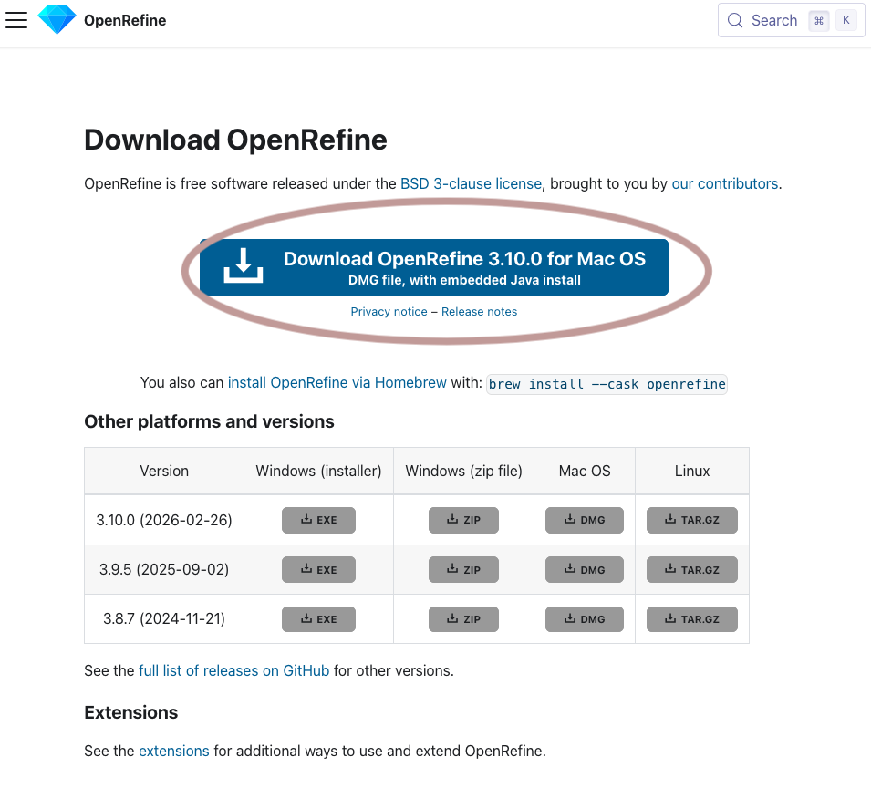


### 2. Install OpenRefine
You can install OpenRefine the same way you would any application. 

You might get a warning that the application is from an unidentified developer. I promise OpenRefine is safe. To get past this warning, follow the steps outlined [here](https://support.apple.com/en-us/102445#:~:text=If%20you%20want%20to%20open%20an%20app%20that%20hasn%E2%80%99t%20been%20notarized%20or%20is%20from%20an%20unidentified%20developer).

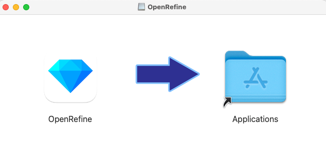


### 3. Open OpenRefine
Double-click on the OpenRefine icon. 

It should open in your web browser; that’s where you’ll work with it. 

Occasionally, for whatever reason, OpenRefine doesn’t launch when you double-click it. If this happens to you, enter localhost:3333 in your browser’s address bar and press return.

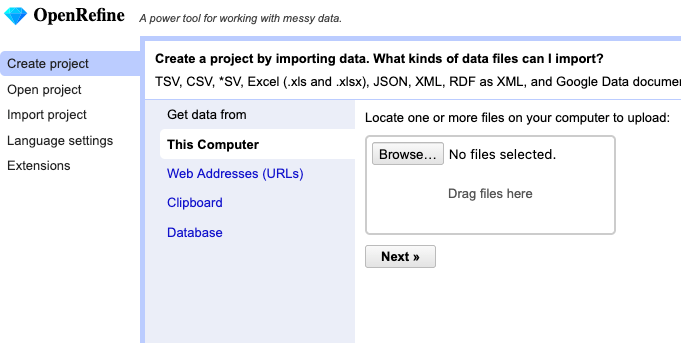


### 4. Open your data file
Click on **Create Project** (1) and then **Choose Files** (2). Navigate to the **artists.csv** file you downloaded earlier and then click **Next** (3).

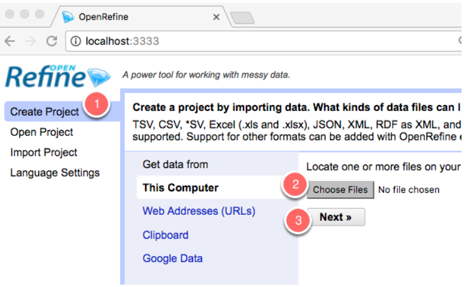


### 5. What the heck is this?
This is just a preview of the way your data will look when you’re working with it in OpenRefine. You shouldn’t have to make any changes; just click on **Create Project**.

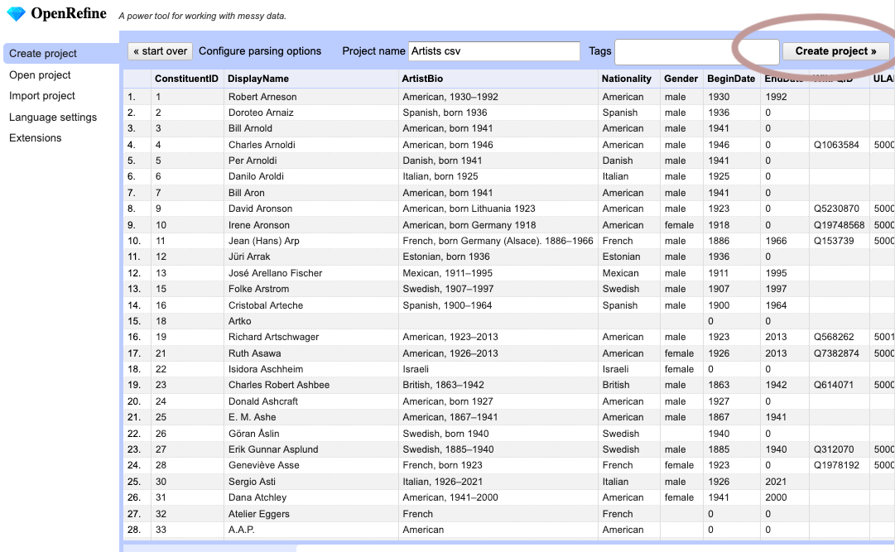


### 6. What the heck is this (part 2)?
This is the main interface you’ll use to work with your data. It sort of looks like Excel, but notice it shows you only 10 records at a time. That’s because you’re not supposed to be working with your data record by record; you’ll find ways to group it into batches and then work with it. We’ll try that next.

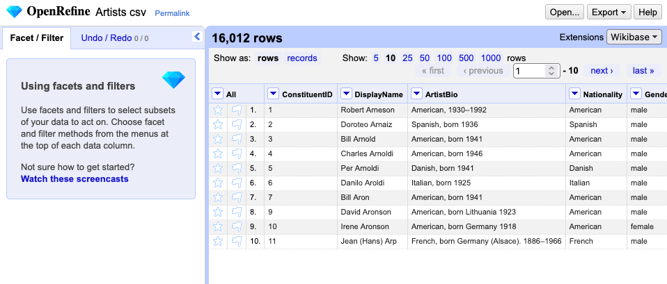


### 7. Create a facet
In OpenRefine, a facet is a way to isolate certain records that share features. It's easier to see what I mean when we work with an example.

At the top of the **Nationality** column, click on the down arrow, then **Facet** and **Text facet**.

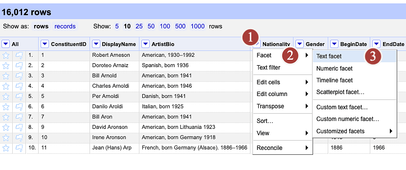


### 8. Investigate your new facet
Take a look at the new box that appears in the left-hand pane of OpenRefine. Can you see what's going on there?

OpenRefine has grouped your dataset according to the entries that appear in the Nationality column.

Try clicking on one of the nationalities. When you do this, OpenRefine displays only those rows with matching values and the changes you make only apply to those rows.

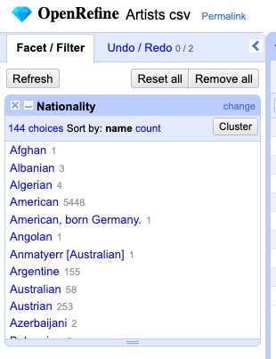


### 9. Layer a facet
You can chain together many different facets to work with your data with any level of specificity.

Let's try this: click on the **Gender** arrow, then **Facet**, then **Text facet** (again.)

A new facet appears, allowing you to select only those rows that correspond to *both* the filters you've applied. For example, in this image, I'm only seeing Bangladeshi men.

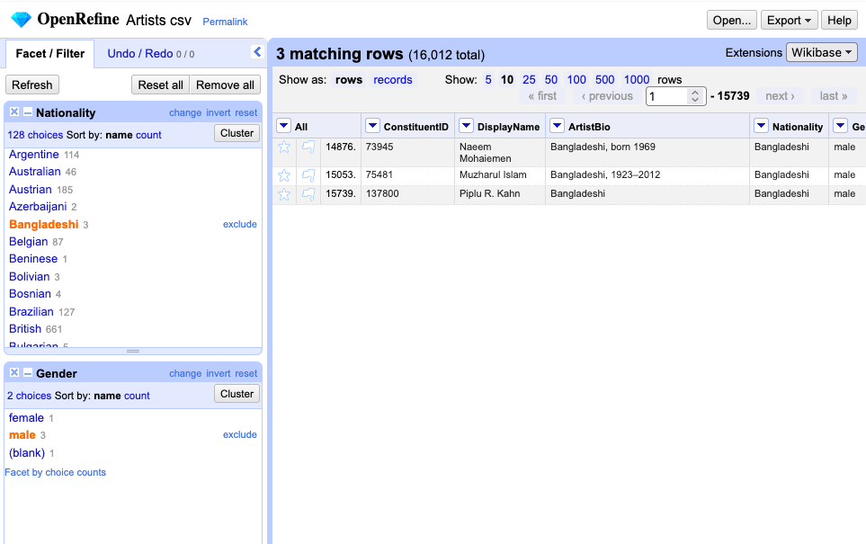


### 10. Delete a facet
Let's get rid of the **Gender** facet by clicking on the **X** at the top left of the box.

While we're at it, let's reset the **Nationality** facet by clicking on the word **reset** at the top right of the Nationality box.

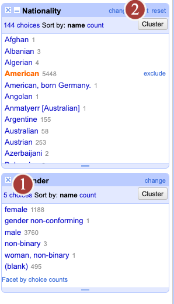


### 11. Edit some data
Looking at the facets for Nationality, I see that one of our artists is described as **American, born Germany**. 

That's good info, but at the same time, if I were trying to group together all the Americans, this artist would be left out.

So let's change the artist's nationality to **American**.

Hover over the facet and click the **edit** button that appears.

What happens when you change the nationality to **American** and then click **Apply?**

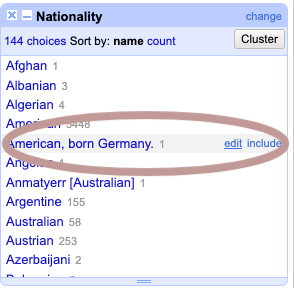


### 12. Working with authorities
OpenRefine is great for cleaning messy data. (If that's what you really want to do with it, you might want to take a look at [this tutorial](https://docs.google.com/presentation/d/1Lz4gwitP73owVoTqNunSSrd74X3zvJ3pbHjn1Si06s0/edit?usp=sharing) instead!) But today we're going to take a look at another of its features: reconciling and extending datasets with existing authorities.

If you look at the column on the data's far right, you'll see that there's a column called **ULAN.**

This stands for **Union List of Artist Names**: an authoritative list of artist information maintained by the Getty. [Take a look at the ULAN website.](https://www.getty.edu/research/tools/vocabularies/ulan/)

You'll see that you can look up an artist to retrieve information about them—including some stuff that isn't included in our dataset.

You'll also notice that each record is identified with a unique ID. For example, Picasso's ID number is 500009666.

Those ID numbers correspond to the values in the ULAN column. And we can use them to add additional information to our dataset!

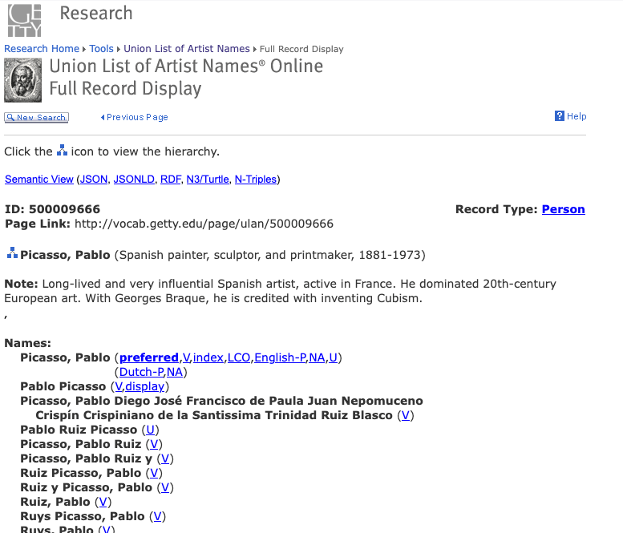


### 13. Get your data ready to match ULAN 1
Head back to your OpenRefine window.

Even though we have ULAN identifiers, they aren't quite in the format that the Getty's service wants in order to provide us with more data.

Instead of just the number, we want the number preceded by **ulan/**. For example, ulan/500027998. We'll make a mass edit to this column in order to make our data fit the Getty's expectation.

From the dropdown arrow next to ULAN, click on **Edit cells** and then **Transform.**

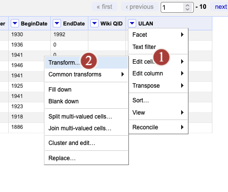


### 14. Get your data ready to transform 2
In the window that pops up, you can transform the cells' contents using something called the General Refine Expression Language (GREL). (You can read more about GREL [here](https://openrefine.org/docs/manual/grel). It's based on regular expressions, if you know what those are.)

You can do a lot of things with GREL. But for now, let's do something pretty simple: in the **Expression** field, enter the following: 

```
"ulan/"+value
```

This instructs OpenRefine to prepend **ulan/** to whatever value is inside the relevant cell.

You can see a preview of your work in the Preview tab.

When you've done that, click **OK**.

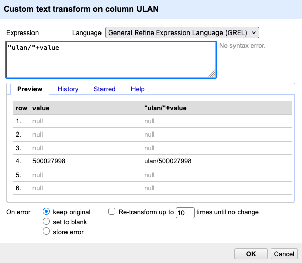


### 15. Reconcile your data 1
Even though *we* know that ULAN refers to the Getty vocabularies, OpenRefine doesn't know that yet. We'll let it know by **reconciling** our data.

(It's called "Reconcile" because you can also use a service like this to standardize your data. But MOMA has already made our data pretty standard, so we're just doing it so that OpenRefine knows that our values are connected to ULAN values.)

From the dropdown arrow next to **ULAN**, click on **Reconcile** and then **Start reconciling...**

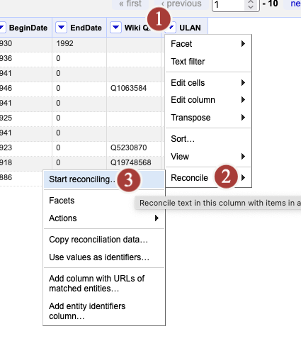


### 16. Reconcile your data 2
In the box that pops up, you'll see that one reconciliation service comes built-in to OpenRefine: Wikidata. As it happens, we also have a column with Wiki IDs, so we could use that service if we wanted to.

But we want to use ULAN and OpenRefine doesn't come with that built in. So we'll add it.

Click on **Add standard service...** Then, in the next window, enter this URL: [https://services.getty.edu/vocab/reconcile/](https://services.getty.edu/vocab/reconcile/). Next, click **Add service**. Finally, click **Next**.

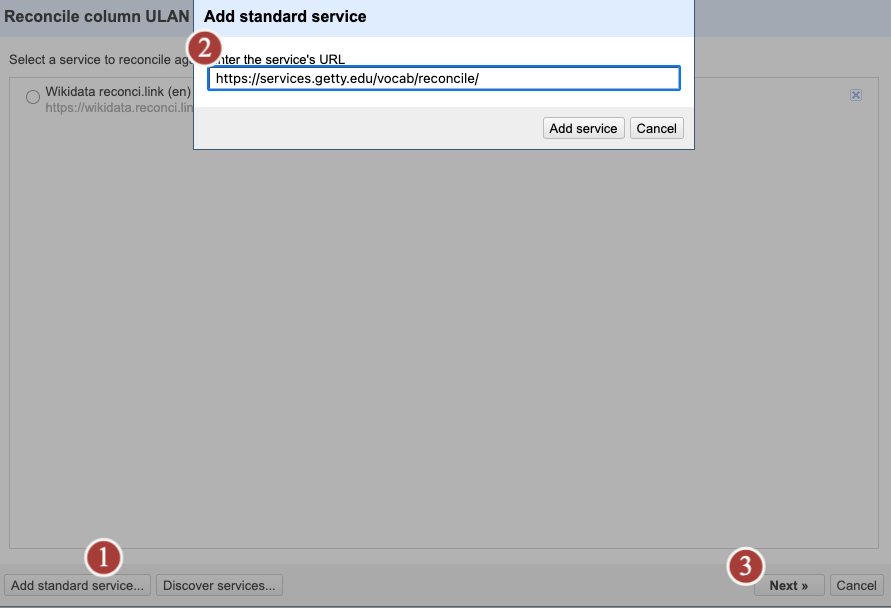


### 17. Reconcile your data with ULAN 4
In the next window, you'll choose some options for the reconciliation process.

The Getty actually offers multiple services, including a Thesaurus of Geographical Names and the Art and Architecture Thesaurus.

But we already know we want ULAN, so select **ULAN search** and click on **Start reconciling...**

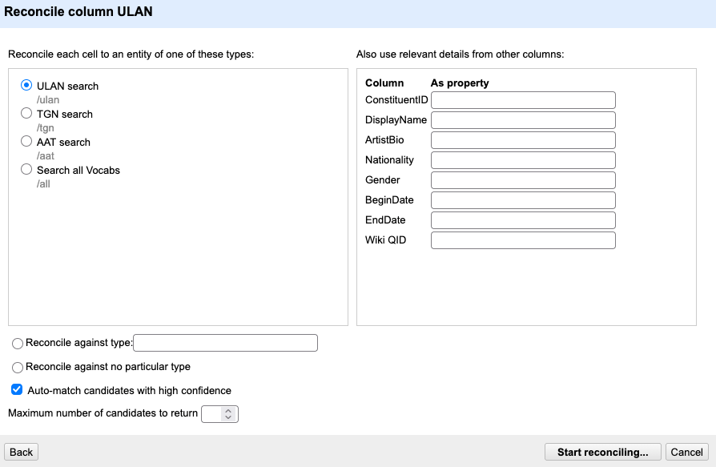


### 18. This will take awhile.
Reconciliation takes awhile. As you wait, consider this quote from "The Museum as Database":

The museum derives its special status from the “un-queryable” structure of its objects. And this museographic status has been concomitant with the aesthetic subject’s relationship to art in the West since the Enlightenment. The “museum as database” posits an opposition to this legacy model, which might be roughly organized under the vague neologism “the digital.” “The digital” semantically smuggles in the ideology of “the digital”—a strange mix of neoliberal thought and Silicon Valley logic in which every existing structure constitutes a problem that can be solved by crowdsourcing, geolocation, algorithms, and shared digital networks. But the construction of these databases involves the biases, desires, and fraught decisions of their architects. Further, they privilege the end user, the optimized query, and the scalable totality. An institution’s newly adopted “open access” mantra does not hold the promise of being culturally autonomous, as one might contrast it to the hegemonic decisions made by a Western museum curator in structuring a collection of cultural artifacts. In fact, the notion of a culturally autonomous database is perhaps the height of ideology itself.

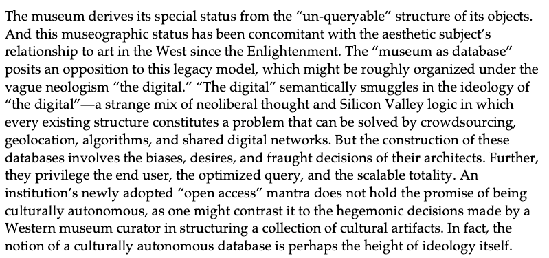


### 19. Reconcile your data 4
Let's complete this process by making sure OpenRefine knows that the numbers in the ULAN column refers to the artist's ULAN ID. Click on the ULAN down arrow, then **Reconcile** again, and then **Use values as identifiers**.

In the next window, select the Getty Vocabularies Reconciliation Service, and then press **Next**. 

You'll notice that the ULAN identifiers now appear in blue, to show that they're connected to the Getty service. If you hover over the values, you'll see a preview of the information that ULAN can provide.

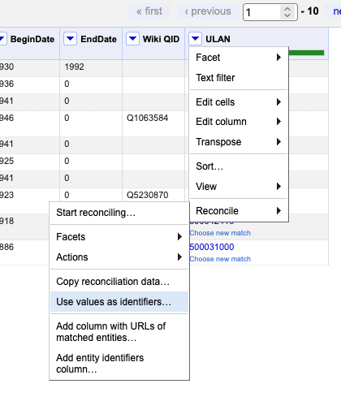


### 20. Add a column based on ULAN 1
OK, now that we've completed the reconciliation process, we can finally start pulling in data from the Getty!

Click on the ULAN arrow, then **Edit column** and **Add columns from reconciled values...**

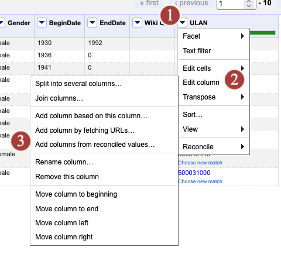


### 21. Add a column based on ULAN 2
From the window that pops up, try clicking on the different **Suggested properties**. You'll notice that when you click on some of them, nothing happens. That's because those properties are associated with a different set of Getty authorities, as indicated by the abbreviations in parentheses: **tgn** stands for Thesaurus of Geographic Names and **aat** stands for the Art and Architecture Thesaurus. Our identifiers work with **ULAN**, not these other services.

When you click on a ULAN property, you'll see a preview of the additional data you'll add. Click on a ULAN property that interests you and then press **OK**.

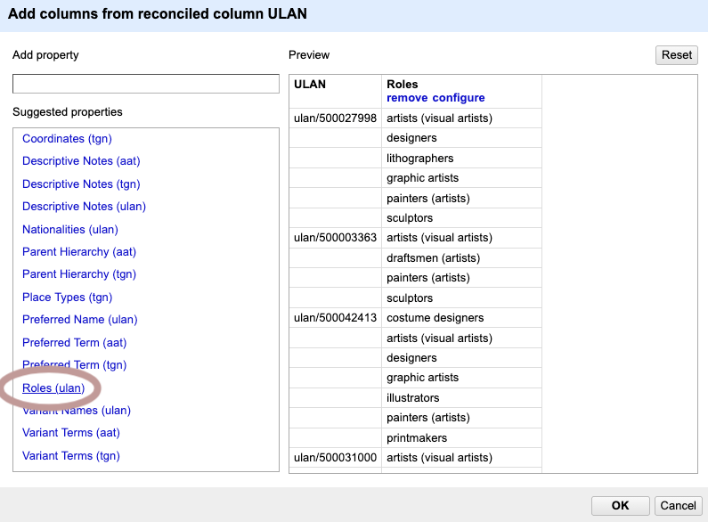


### 22. This will take awhile.
While you're waiting for your new column, think about the quote you examined above.

Consider the following question: What does it mean for an object to be "un-queryable"? What do we gain and lose when we make objects "query-able"—that is, when we work with data as we do in OpenRefine?

Write your answer on your index card.

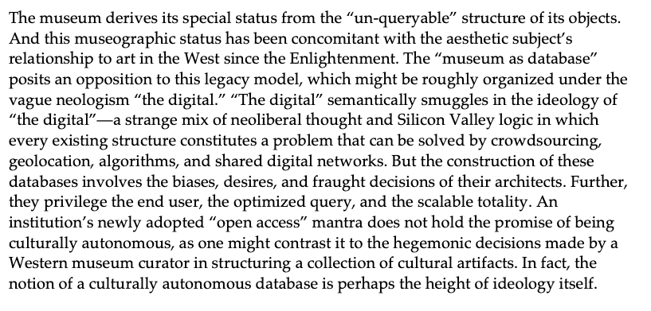


### 23. You extended your data!
You should now see an additional column that contains the information you retrieved from the Getty's vocabularies. Great job!

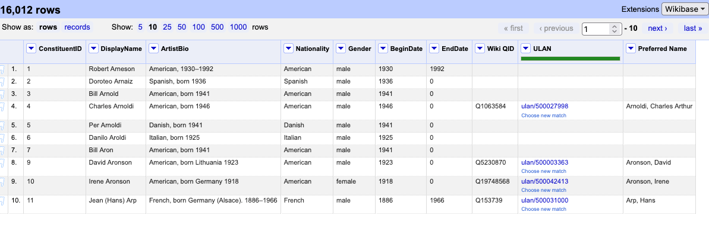


### 24. Export your data
You can export your data from OpenRefine as many times as you want. Each time the export will only contain the data that hasn't been filtered out.

To export your extended data, click on **Export** and then **Comma-separated value**. 

If you've finished early, see if you can complete the same process with the **Wiki QID column**!

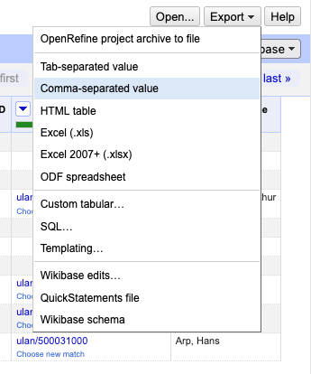


